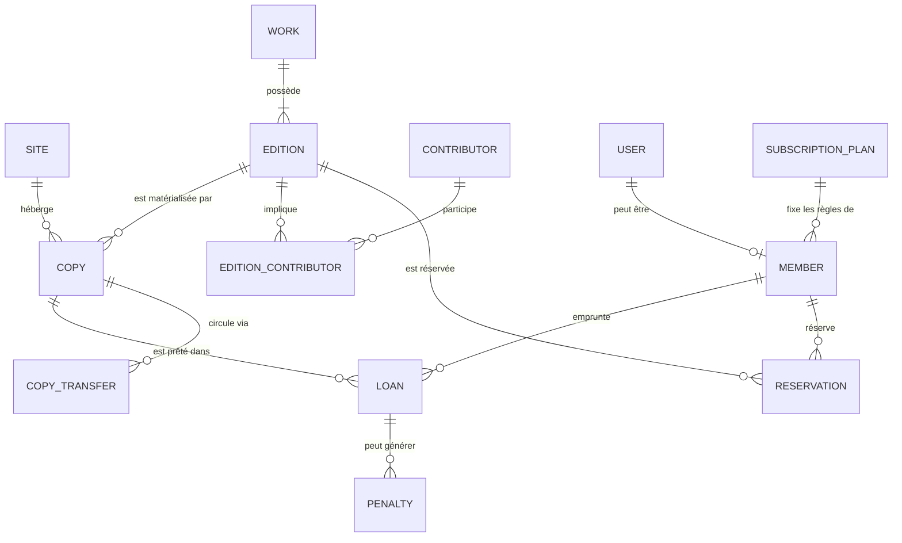

# Modèle de données

> **Version initiale (brouillon)** : sera affinée à l'étape de conception, puis alignée sur les entités réelles.

## Diagramme

## Glossaire FR ↔ code

| Français | Code |
|---|---|
| Médiathèque (site) | `Site` |
| Œuvre | `Work` |
| Édition | `Edition` |
| Exemplaire | `Copy` |
| Adhérent | `Member` |
| Formule d'abonnement | `SubscriptionPlan` |
| Prêt | `Loan` |
| Réservation | `Reservation` |
| Pénalité | `Penalty` |
| Transfert | `CopyTransfer` |

## Choix de conception

À compléter au fil de la conception (voir aussi `DECISIONS.md`).
