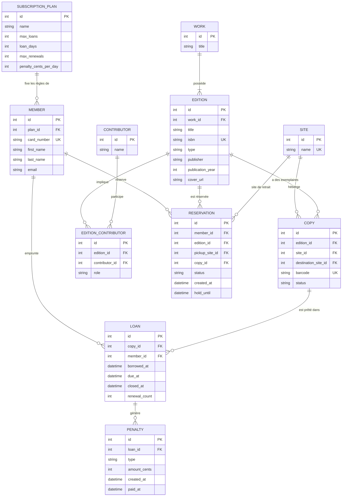

# Modèle de données

Réseau de deux médiathèques de quartier (≈ 8 000 documents, ≈ 1 500 adhérents). Ce document décrit le modèle de données et explique les choix de conception. Les noms des entités et des statuts sont ceux du code (`src/Entity/`, `src/Enum/`) ; le glossaire en fin de document donne la correspondance avec le vocabulaire métier.

## 1. Diagramme

Le compte de connexion (`User`, rôles adhérent / bibliothécaire / administrateur) sera ajouté au niveau 3.

## 2. Comment lire ce modèle

Chaque rectangle est une **table** MySQL, chaque ligne un **champ**. `PK` désigne l'identifiant de la table, `FK` un champ qui pointe vers une autre table, `UK` un champ qui ne peut pas avoir deux fois la même valeur. Les traits relient les tables : `||--o{` se lit « un seul d'un côté, plusieurs de l'autre » (un adhérent a plusieurs prêts ; un prêt a un seul adhérent).

## 3. Les choix de conception

### 3.1 Œuvre, édition, exemplaire
Un même livre existe à trois niveaux, et chacun répond à un besoin différent :
- `Work` : la création elle-même (« Les Misérables »).
- `Edition` : une publication précise (ISBN, éditeur, année, support).
- `Copy` : l'objet physique, avec un code-barres. C'est lui qui est prêté.

Le prêt se fait sur l'**exemplaire** (on sait qui détient quel objet), la réservation se fait sur l'**édition** (l'adhérent veut un document précis, peu importe l'exemplaire), et les statistiques peuvent se calculer à n'importe lequel des trois niveaux.

### 3.2 Auteurs, traducteurs, illustrateurs
Une table `Contributor` (la personne) et une table de liaison `EditionContributor` qui porte un **rôle**. Une personne peut tenir plusieurs rôles sur une édition (auteur et illustrateur d'une BD), et un document peut avoir plusieurs auteurs. Le lien est porté par l'**édition**, car un traducteur ou un illustrateur est propre à une édition. Une contrainte d'unicité (édition, personne, rôle) évite les doublons.

### 3.3 Un exemplaire a un site, et éventuellement une destination
`Copy.site` indique où se trouve l'exemplaire. Pendant un transfert entre médiathèques, son statut est `InTransit` et `destinationSite` indique où il va. On ne garde pas d'historique des transferts : le sujet demande de **faire circuler** les exemplaires, pas de les tracer. Un historique pourra être ajouté plus tard.

### 3.4 Le statut du prêt se déduit des dates
Un prêt est « en cours » tant que `closed_at` est vide. Il est « en retard » si `due_at` est dépassé. Stocker un statut « en retard » obligerait à le tenir à jour en permanence et risquerait de devenir incohérent avec les dates.

### 3.5 Montants en centimes
Les pénalités et les tarifs sont stockés en **entiers (centimes de dirham)**. Les nombres décimaux provoquent des erreurs d'arrondi (0,1 + 0,2 ≠ 0,3), ce qui est inacceptable pour de l'argent.

### 3.6 Le même exemplaire ne peut pas être prêté deux fois
MySQL ne sait pas déclarer « un seul prêt ouvert par exemplaire » avec une simple contrainte. Les opérations de prêt, retour et mise de côté se feront donc dans une **transaction qui verrouille la ligne de l'exemplaire** : deux personnes qui empruntent le même exemplaire au même instant ne passent pas toutes les deux. Ce comportement sera couvert par un test automatisé au niveau 2.

### 3.7 Les règles métier vivent dans les services
Les entités décrivent les données ; les règles (limites de prêts, file d'attente, prolongation, pénalités) sont dans `src/Service/`. Les limites elles-mêmes (nombre de prêts, durée, prolongations, tarif de pénalité) sont dans `SubscriptionPlan`, donc modifiables sans toucher au code.

## 4. Glossaire

| Français | Code |
|---|---|
| Médiathèque (site) | `Site` |
| Œuvre | `Work` |
| Édition | `Edition` |
| Personne créditée | `Contributor` |
| Rôle d'une personne sur une édition | `EditionContributor` |
| Exemplaire | `Copy` |
| Formule d'abonnement | `SubscriptionPlan` |
| Adhérent | `Member` |
| Prêt | `Loan` |
| Réservation | `Reservation` |
| Pénalité | `Penalty` |

## 5. Limites connues
- Pas d'historique des transferts d'exemplaires.
- Pas de paiement en ligne des pénalités : le montant et la date de paiement sont enregistrés.
- Pas d'envoi d'e-mails : les notifications passent par le statut de la réservation, consultable par l'adhérent.
